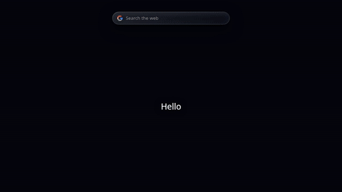

# ASCII Aesthetic — New Tab (Browser Extension)

> A lightweight aesthetic new tab extension — living ASCII animals drift across your screen: butterflies, koi, jellyfish, dragonflies, frogs, cranes, and crabs, with a personalized time-of-day greeting, an ASCII clock, a liquid-glass search bar, and your shortcuts. Not a wallpaper — your new tab, alive.

**Live demo:** [ascii-animals-extension.antideploy.app](https://ascii-animals-extension.antideploy.app)

## 🎬 Live Preview



Switch animals from the hidden Tweaks panel (bottom-right button), click anywhere to startle them, and retune direction and speed live — a recording of the real new tab page, not a mockup.

---

## ✨ Features

- **Dynamic Interactive Animals:** 7 beautiful animated ASCII creatures with realistic physics, wing flapping, and behavioral AI (Butterflies, Koi, Jellyfish, Dragonflies, Frogs, Cranes, Crabs).
- **Multiple Creature Modes:** Switch between different animals anytime using the Tweaks panel.
- **Personalized Greeting:** Prompts for your name on first install (`Good morning, [Name]`), saved locally in your browser. Click on your name anytime to edit or change it.
- **Auto Browser Shortcuts:** Automatically fetches and displays your browser's top visited sites (`chrome.topSites`). Right-click any shortcut to **Edit** (custom name/URL) or **Remove** it.
- **Multi-Browser Auto-Detect:** Automatically displays the native browser mark for **Brave**, **Google Chrome**, or **Microsoft Edge** with zero external image files.
- **Compact ASCII Clock:** Character-grid clock featuring 12-hour time, AM/PM, and subtle ambient glow.
- **Liquid Glass Search Bar:** Minimalist search pill powered by Google search.
- **Interactive Ripples:** Click anywhere on the canvas to startle the creatures and watch water ripples smoothly dissipate into a clean, dark grid.
- **Tweaks Control Panel:** Click the settings icon at the bottom-right corner to customize animal types, counts, speeds, movement, and visual themes.
- **Lightweight by Design:** Zero runtime dependencies and a tiny footprint — your new tab stays fast and your browser stays light.

---

## 🚀 Installation (Brave / Chrome / Edge)

1. Clone or download this repository to your computer:
   ```bash
   git clone https://github.com/sushilbyte7/ascii-animals-extension.git
   ```
2. Open your browser's Extensions page:
   - **Brave:** `brave://extensions`
   - **Chrome:** `chrome://extensions`
   - **Edge:** `edge://extensions`
3. Toggle **Developer mode** to **ON** (top-right corner).
4. Click **Load unpacked** (top-left).
5. Select this `ascii-animals-extension` folder.
6. Open a new tab (`Ctrl + T`) — enter your name and enjoy!

---

## 🛠️ Tech Stack & Credits

- Built with HTML5 Canvas, modern ES Modules, and vanilla CSS.
- Forked & redesigned from Stephen's [ascii-animals](https://github.com/DesignerStephen1/ascii-animals.git) (MIT License, Copyright (c) 2026 drewdi).
- ASCII clock inspired by pursurer's `AsciiMark` (MIT License, Copyright (c) 2026 pursurer).

---

## ⬇️ Downloads

- **Stable releases:** [GitHub Releases](https://github.com/sushilbyte7/ascii-animals-extension/releases) — download the latest `ascii-aesthetic-vX.Y.zip`, unzip it, and load it unpacked (see Installation above).

---

## 📄 License

This project is licensed under the Apache License 2.0 — see [LICENSE](LICENSE) for details.

Parts of the code come from other MIT-licensed projects and keep their MIT license: Stephen's ascii-animals ([LICENSE-MIT](LICENSE-MIT)) and pursurer's AsciiMark ([LICENSE-pond](LICENSE-pond)).
